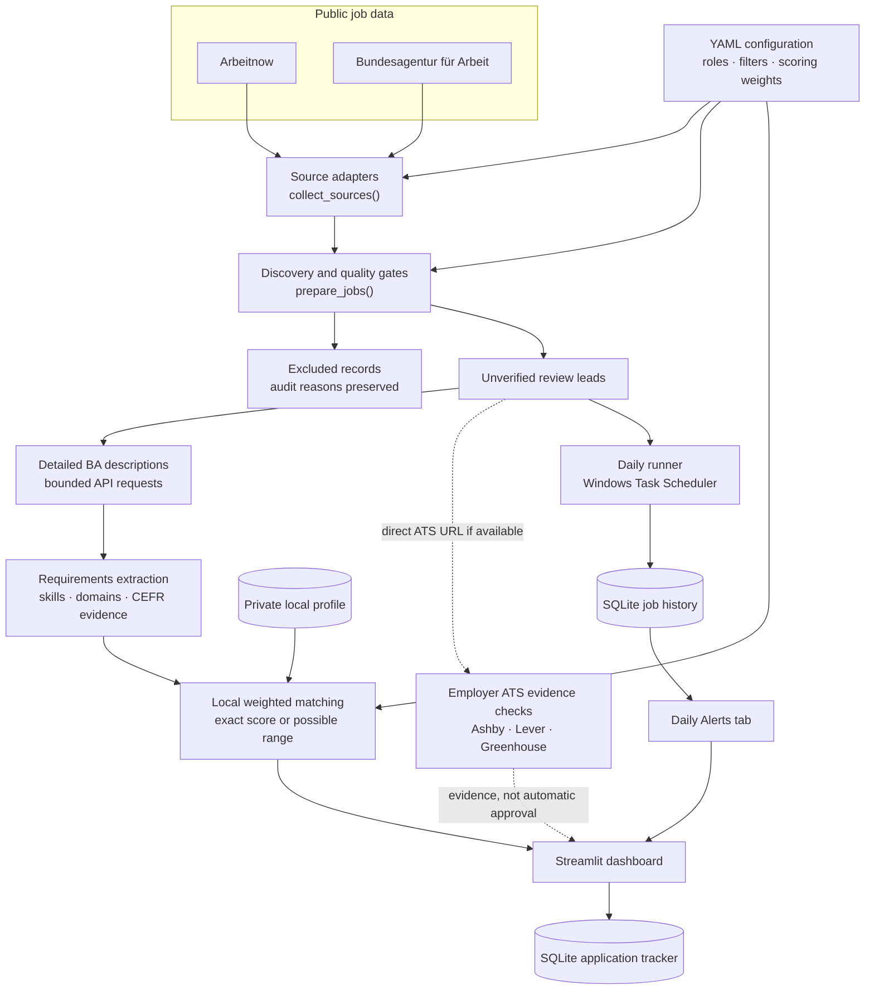
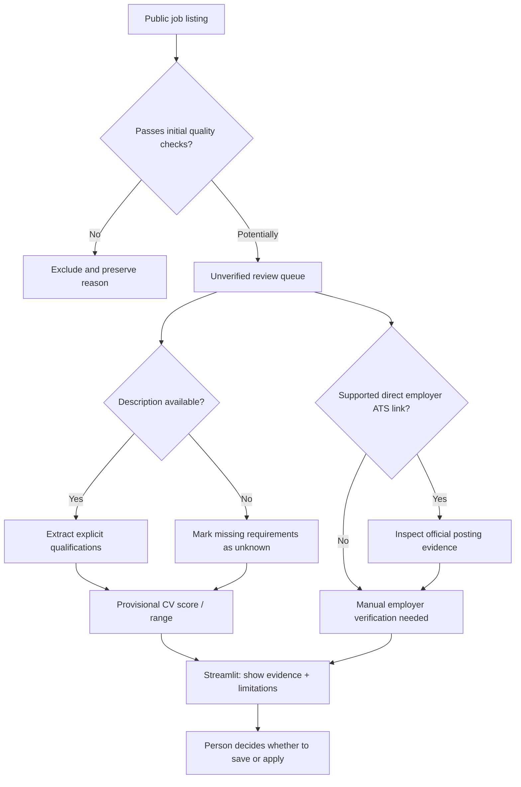
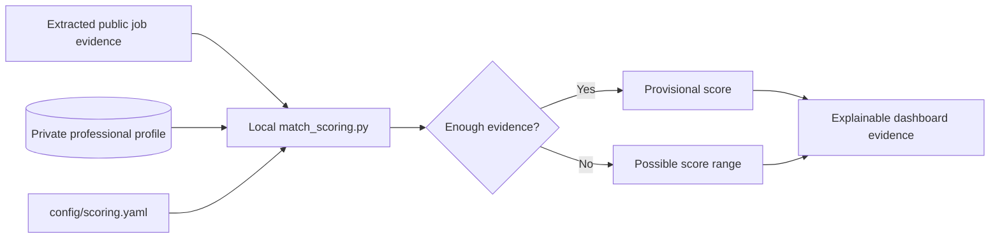
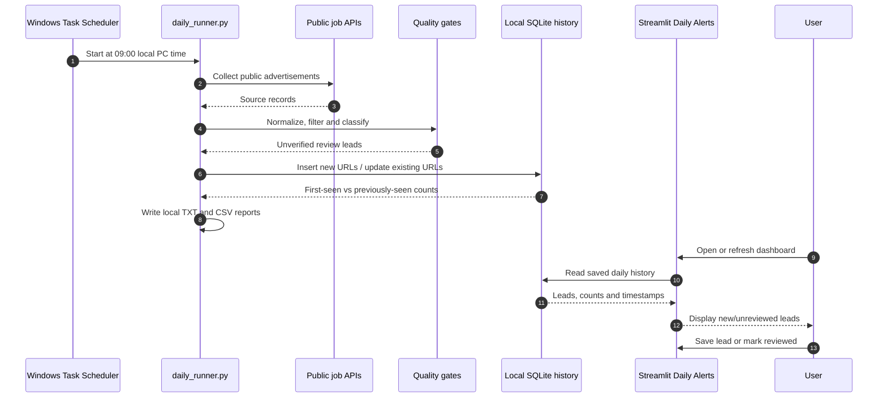

<div align="center">

# ✦ JobRadar Germany
### Local-first job discovery & career intelligence

**Discover jobs in Germany · Inspect requirements · Estimate CV fit · Track applications · Review daily alerts**


*A practical Python project combining public APIs, data-quality engineering, explainable matching, agent workflows, interactive analytics, and automation.*

</div>

> [!IMPORTANT]
> **Project status:** JobRadar is a **working local MVP**. Its leads and CV match ranges are **provisional**, not confirmed-open vacancies or hiring probabilities. Personal data is deliberately excluded from Git. A public Streamlit Cloud demo has **not** been deployed.

---

## Table of contents

1. [Why this project exists](#1-why-this-project-exists)
2. [What the application does](#2-what-the-application-does)
3. [System architecture](#3-system-architecture)
4. [How we built it, step by step](#4-how-we-built-it-step-by-step)
5. [How CV matching works](#5-how-cv-matching-works)
6. [How Daily Alerts work](#6-how-daily-alerts-work)
7. [Project structure](#7-project-structure)
8. [Running locally](#8-running-locally)
9. [Configuration, security and privacy](#9-configuration-security-and-privacy)
10. [Testing and observed results](#10-testing-and-observed-results)
11. [Limitations and roadmap](#11-limitations-and-roadmap)
12. [Engineering lessons](#12-engineering-lessons)

---

## 1. Why this project exists

Searching across German job portals is repetitive: advertisements appear in different formats, are duplicated, sometimes lack essential requirements, and may remain visible even when applications are no longer accepted. Evaluating each vacancy against a CV and tracking applications creates additional manual work.

**JobRadar Germany** was built to answer a practical question:

> **Which potentially relevant opportunities can I find today, what evidence supports their fit, and which still need verification?**

It turns a group of Python scripts into a local application with a repeatable process:

1. **Discover** public jobs from multiple providers.
2. **Filter** unsuitable, stale, duplicate, or out-of-scope leads.
3. **Enrich** advertisements with available detailed descriptions and employer ATS evidence.
4. **Extract** explicitly stated qualifications in English and German.
5. **Compare** those requirements against a locally stored professional profile.
6. **Review** results in a Streamlit dashboard and save interesting jobs.
7. **Repeat** the public search daily and display newly discovered leads in **Daily Alerts**.

**A lead is not a recommendation.** Being discovered, matching a role, matching a CV, and being confirmed open are separate facts.

---

## 2. What the application does

| Feature | How it works | Status |
|---|---|---|
| Live job collection | Arbeitnow + Bundesagentur für Arbeit | ✅ Working |
| Target-role coverage | 43 configured role families, English/German search terms | ✅ Working |
| Quality filtering | Title, geography, seniority, freshness, duplication, application evidence | ✅ Working |
| Detailed BA descriptions | Bounded official job-detail requests for review leads | ✅ Working |
| Requirements extraction | Rule-based skills, experience areas, stated CEFR levels + evidence excerpts | ✅ Working; not exhaustive |
| CV comparison | Weighted local engine; score ranges when evidence is missing | 🟡 Provisional |
| Employer ATS verification | Ashby, Lever, Greenhouse public posting checks | 🟡 Coverage limited |
| Interactive dashboard | Search, audit, evidence, charts, CSV export | ✅ Working |
| Application tracker | SQLite statuses, notes, follow-up dates | ✅ Working |
| Daily job history | URL-based first-seen tracking and local reports | ✅ Working |
| Daily Alerts tab | New/unreviewed leads from local history, no email needed | ✅ Working |
| Daily automation | Windows Task Scheduler at 09:00 local time | ✅ Configured and tested |
| Confirmed-open recommendations | Requires stronger employer acceptance evidence | ⏳ Not complete |
| Email notifications | Not required or configured | — |
| Streamlit Community Cloud | Separate sanitized demo is still needed | ⏳ Not deployed |

JobRadar **never automatically submits job applications**.

---

## 3. System architecture

### A. Complete data flow



> **Two intentionally separate paths:** Clicking **Run live job discovery** in Streamlit fetches descriptions and calculates provisional **local CV matching**. The **scheduled runner** archives public review leads for Daily Alerts; those alert records do **not** automatically include CV scores.

### B. Evidence and decision-making



An ATS listing alone does not prove the application form is accepting submissions. **No automated stage promotes an unverified lead to a confirmed-open recommendation.**

---

## 4. How we built it, step by step

Each stage was introduced to answer a specific engineering or business question.

| Stage | Problem | Implementation |
|---|---|---|
| **01 — Define relevance** | Which roles and locations are in scope? | `config/job_roles.yaml` and `config/search_filters.yaml` |
| **02 — Connect sources** | How can real vacancies be collected? | `src/sources/arbeitnow.py`, `src/sources/arbeitsagentur.py` |
| **03 — Normalize records** | How do different API responses become comparable? | `src/services/job_discovery.py` with source URLs, identity and role metadata |
| **04 — Apply quality gates** | Which records must be held or excluded? | Seniority, geography, freshness, duplicates, vacancy and application-link checks |
| **05 — Fetch missing details** | How do we retrieve requirements not included in BA search results? | `src/services/ba_details.py` and limited BA job-detail requests |
| **06 — Extract evidence** | What qualifications does the advertisement actually mention? | `src/services/job_requirements.py`, English/German rules and excerpts |
| **07 — Estimate fit** | How closely does the known evidence match the profile? | `src/services/match_scoring.py`, weighted dimensions and unknown-value ranges |
| **08 — Explore agent orchestration** | Can agent tasks coordinate supplementary review? | Separate CrewAI modules in `src/crew/`; invoked explicitly |
| **09 — Build the interface** | How should results be investigated and acted upon? | Streamlit overview, job cards, evidence, exclusions and SQLite tracker |
| **10 — Automate recurrence** | How do we avoid searching manually every day? | `daily_runner.py`, idempotent URL history, TXT/CSV reports, Windows scheduler |
| **11 — Add in-app alerts** | Can newly observed jobs be reviewed without an email service? | Daily Alerts tab and local reviewed/unreviewed marker |
| **12 — Harden employer evidence** | Can we independently establish posting facts? | `employer_gate.py` for supported public ATS providers |

### Why the stages are separate

A **publicly advertised** job is not necessarily **eligible**; an eligible job is not necessarily a **good CV match**; and a good CV match is not necessarily **currently open**. The design retains these distinctions rather than reducing all evidence to a misleading single label.

---

## 5. How CV matching works

### A. Requirement extraction

`src/services/job_requirements.py` works with public description text—not job titles alone:

1. Convert HTML into readable text.
2. Detect headings such as *Your profile*, *Requirements*, *Anforderungen* and *Das bringst du mit*.
3. Recognize explicitly mentioned technologies and experience domains.
4. Exclude optional phrases such as *nice to have* or *wünschenswert* where detected.
5. Extract CEFR levels such as **German B2** only when explicitly stated.
6. Retain supporting excerpts to make detections auditable.
7. Leave unsupported dimensions **unknown** instead of guessing.

This is **rule-based extraction**, not a guarantee that every mandatory requirement was found.

### B. Weighted fit estimation

Weights are defined in `config/scoring.yaml`:

| Dimension | Weight |
|---|---:|
| Technical skills | **35%** |
| Relevant experience | **25%** |
| Language requirements | **15%** |
| Location / work mode | **15%** |
| Seniority | **10%** |
| **Total** | **100%** |



For example, a **50–75/100** range does **not** represent a 62.5% chance of getting hired. It reflects uncertainty in the scoring dimensions. The dashboard shows that uncertainty rather than fabricating precision.

### C. Local-only CV data

The professional profile is stored under `data/private/` and excluded from Git. Local matching can read it on the user's PC. Neither the public daily runner nor the in-app Daily Alerts workflow sends it to a job provider or cloud LLM.

---

## 6. How Daily Alerts work

The working personal workflow avoids third-party email providers entirely: a Windows task populates history, and Streamlit displays the results.



### Meaning of the timestamps

- **`first_seen`** — when JobRadar first encountered this URL.
- **`last_seen`** — when a later run observed the same URL.
- **`seen_count`** — number of times it appeared in saved runs.

**Important:** “New” means **new to JobRadar's local history**, not necessarily published today. The first run of an empty database will mark all observed leads as new.

### Different databases, different purposes

| Local file | Stores |
|---|---|
| `data/private/jobradar_history.sqlite3` | First-seen URLs, duplicate history and daily-run statistics |
| `data/private/jobradar_alert_state.sqlite3` | Last time alerts were marked reviewed |
| `data/private/jobradar_tracker.sqlite3` | Saved applications, statuses, notes and follow-up dates |
| `data/private/professional_profile.json` | Local professional-profile evidence |
| `data/private/reports/` | Generated public-only TXT/CSV job reports |

These are **local runtime files**. None is included in GitHub.

---

## 7. Project structure

```text
jobradar-germany/
├── .gitignore                       # Privacy exclusions
├── streamlit_app.py                 # Dashboard and Daily Alerts
├── config/
│   ├── job_roles.yaml              # 43 role families and alternatives
│   ├── search_filters.yaml         # Eligibility criteria
│   └── scoring.yaml                # Weighted matching configuration
├── src/
│   ├── profile.py                  # Local profile processing logic
│   ├── sources/
│   │   ├── arbeitnow.py            # Arbeitnow adapter
│   │   └── arbeitsagentur.py       # Bundesagentur adapter
│   ├── services/
│   │   ├── job_discovery.py        # Source collection and review queues
│   │   ├── job_filter.py           # Role filtering
│   │   ├── location_filter.py      # Location checks
│   │   ├── geography.py            # Region / work-mode classification
│   │   ├── seniority_filter.py     # Seniority rules
│   │   ├── vacancy_validator.py    # Freshness and quality checks
│   │   ├── application_links.py    # Application-link inspection
│   │   ├── employer_verifier.py    # Employer verification utilities
│   │   ├── employer_gate.py        # Official ATS evidence gate
│   │   ├── ba_details.py           # Detailed BA job descriptions
│   │   ├── job_requirements.py     # Explainable requirements extraction
│   │   ├── match_scoring.py        # Local weighted match estimation
│   │   └── daily_runner.py         # Scheduled search history and reports
│   └── crew/
│       ├── agents.py               # Agent definitions
│       ├── tasks.py                # Agent tasks
│       ├── workflow.py             # Crew orchestration
│       ├── llm_config.py           # LLM configuration
│       ├── live_jobs.py            # Public-job agent integration
│       └── run_crew.py             # Explicit agent entry point
└── data/
    └── private/                     # LOCAL ONLY — excluded by .gitignore
        ├── professional_profile.json
        ├── jobradar_history.sqlite3
        ├── jobradar_alert_state.sqlite3
        ├── jobradar_tracker.sqlite3
        └── reports/
```

> The `data/private/` tree is illustrative. It exists on the development PC, **not** in a clean GitHub checkout. Never commit actual CVs, credentials or application history.

**Start reading the code here:** [Streamlit app](streamlit_app.py) → [job discovery](src/services/job_discovery.py) → [BA detail retrieval](src/services/ba_details.py) → [requirement extraction](src/services/job_requirements.py) → [CV matching](src/services/match_scoring.py) → [daily runner](src/services/daily_runner.py) → [ATS evidence gate](src/services/employer_gate.py). The [scoring rules](config/scoring.yaml) and [role definitions](config/job_roles.yaml) show the business logic without requiring you to inspect Python first.

---

## 8. Running locally

### Prerequisites

- Windows and PowerShell (for the currently implemented scheduler).
- Python with the project dependencies installed in a Conda environment.
- Internet access for real public job searches.
- No Gmail account integration, app password or 2-Step Verification is required for **Daily Alerts**.

The development environment is named `crewai_env`. A version-pinned `requirements.txt` or Conda environment lock has **not yet been committed**, so a fresh clone needs its dependencies provisioned before running. Core components include **Streamlit**, **Requests** and **PyYAML**; the separate agent workflow additionally uses CrewAI and its configured provider.

### 1. Activate the environment

```powershell
conda activate crewai_env
```

### 2. Test the dashboard without making API requests

```powershell
python -m py_compile streamlit_app.py
python streamlit_app.py --self-test
```

### 3. Launch Streamlit

```powershell
python -m streamlit run streamlit_app.py --server.address 127.0.0.1 --server.port 8502 --browser.gatherUsageStats false
```

Open **http://127.0.0.1:8502**.

**Tabs:** Overview · Daily Alerts · Discover jobs · Match evidence · Excluded/audit · My applications · About.

### 4. Run a detailed search

Click **Run live job discovery** in the sidebar. This path fetches live public advertisements, retrieves available descriptions and, if enabled, calculates provisional CV fit evidence **on the local machine**.

### 5. Generate a daily history report

In another terminal:

```powershell
python -m src.services.daily_runner --self-test
python -m src.services.daily_runner --run
python -m src.services.daily_runner --history
```

The runner updates local SQLite history and generates reports in `data/private/reports/`. Open or refresh **Daily Alerts** in Streamlit to see the saved leads.

### 6. Test supporting modules

```powershell
python -m src.services.job_requirements --self-test
python -m src.services.ba_details --self-test
python -m src.services.employer_gate --self-test
python streamlit_app.py --self-test
```

These tests use synthetic or mocked data. **Passing tests does not prove that any current job is accepting applications.**

### 7. Review the Windows schedule

The development PC has a Windows Task Scheduler task called **`JobRadar Germany Daily`** that executes `python -m src.services.daily_runner --run` at **09:00 local computer time** using the configured Conda Python interpreter.

```powershell
Get-ScheduledTask -TaskName "JobRadar Germany Daily"
Get-ScheduledTaskInfo -TaskName "JobRadar Germany Daily"
```

Scheduling is **machine-specific**. Cloning the repository will not install this Windows task. The PC must be available for the scheduled run.

---

## 9. Configuration, security and privacy

### Configuration files

| File | Purpose |
|---|---|
| `config/job_roles.yaml` | Role families and search alternatives |
| `config/search_filters.yaml` | Search scope and eligibility rules |
| `config/scoring.yaml` | Weights and match thresholds |

### Privacy safeguards

- `data/private/` is ignored by Git and contains real profile data, databases, notes and reports.
- Generated CrewAI files, course materials and local runtime artifacts are excluded.
- Public source navigation requires HTTPS URLs.
- Untrusted public titles are escaped for CSV exports to reduce spreadsheet formula injection risk.
- SQLite transactions are followed by **explicit connection closure**, including on Windows.
- **No automatic applications** or unrequested CV uploads are performed.

`.gitignore` does **not** remove secrets already tracked or committed. Review staged files before any public push.

### CrewAI is optional, not the scheduled dashboard engine

The repository includes a separate CrewAI workflow. It is intended for explicitly initiated analysis of public job content. The 09:00 daily runner and the Daily Alerts tab do **not** automatically invoke a cloud LLM, and local CV data must not be sent to cloud agents.

### Streamlit Cloud deployment

This README describes the working **local** application. Deploying it unchanged to Streamlit Community Cloud would not carry over its Windows scheduler or private SQLite files; local cloud-instance storage is also not a durable substitute for a database service.

A portfolio-safe public deployment should have **sanitized example data**, reproducible dependency versions, separation from the personal dashboard and appropriate persistent storage. **Deployment is not complete yet.**

---

## 10. Testing and observed results

### Engineering checks

| Test area | What was checked |
|---|---|
| API/URL input | Unsafe schemes, incorrect job references and invalid identifiers |
| Filtering | Role relevance, location and seniority exclusions, duplicates |
| Requirement extraction | English/German evidence, optional skills, absent descriptions |
| BA details | Mocked detail requests, reference validation and source joins |
| CV matching | Preserve unknown dimensions as score ranges |
| ATS checks | Stale, non-full-time, unlisted and mismatched postings are not approved |
| SQLite | Preserve existing application notes, duplicate handling, schema migrations |
| Daily Alerts | First-seen dates, unread marker, local filters and CSV export |
| Windows | Explicit database closure avoids locked temporary files |
| Scheduling | Daily task created and manually executed successfully |

### Historical development-run examples — 21 October 2026

These values are **snapshots from separate test runs**, not live counters or guarantees.

| Description-enrichment preview | Result |
|---|---:|
| Public source records | **968** |
| Review leads | **22** |
| Descriptions available after enrichment | **18** |
| BA details successfully retrieved | **12 / 12** |
| Leads with extracted skill evidence | **10** |
| Fully determined exact CV scores | **0** |

| Daily-history run | Result |
|---|---:|
| Public source records | **979** |
| Review leads | **20** |
| First-seen leads in the new local history | **20** |
| Confirmed-open recommendations | **0** |

**Interpretation:** Discovery, history and basic evidence extraction are functional. Independent employer confirmation and complete score evidence are still limited. The system **surfaces those gaps** instead of creating unjustified confidence.

---

## 11. Limitations and roadmap

### Current limitations

- **Employer links:** Some job portals do not expose direct employer ATS URLs. In one verification run, **0 of 22** review leads could be checked by the supported ATS gate.
- **Application acceptance:** A public posting or application URL is not proof that a form currently accepts submissions.
- **Missing qualifications:** Some jobs lack detailed descriptions, and rule-based extraction may miss or misclassify phrases.
- **CV matching uncertainty:** Incomplete requirements or profile evidence produce ranges rather than reliable exact rankings.
- **Daily scope:** Scheduled searches archive public leads, not complete per-job CV scoring.
- **Local execution:** The Windows task needs the configured computer to be available.
- **Deployment:** No public hosted demo, persistent hosted database or pinned environment yet.

### Roadmap

- [ ] Improve employer application-link discovery and verifiable posting coverage.
- [ ] Audit and expand English/German extraction patterns.
- [ ] Improve confidence and completeness of score evidence.
- [ ] Connect more validated evidence to daily review reports.
- [ ] Add dependency pinning and CI regression checks.
- [ ] Build a **sanitized public Streamlit demo** separate from personal records.
- [ ] Evaluate durable hosted storage if cloud hosting becomes necessary.

---

## 12. Engineering lessons

JobRadar is a learning project that brings several disciplines together:

- **Data engineering:** APIs, normalization, deduplication, quality gates and idempotent historical loads.
- **Business analytics:** Role priorities, scoring weights, explainable uncertainty and outcome-oriented design.
- **Applied NLP:** English/German requirement detection and evidence excerpts.
- **Agentic AI:** Optional CrewAI agents, tasks and orchestration.
- **Application engineering:** Streamlit, SQLite, CLI commands, tests and scheduled execution.
- **Privacy engineering:** Separate private storage, scoped external calls and no automatic applications.
- **Product development:** Moving iteratively from individual scripts to a useful personal dashboard.

> **Main lesson:** A useful AI-enabled product must explain **what it knows, how it knows it, and what it still cannot verify**.

---

<div align="center">

**JobRadar Germany** · Built with Python, Streamlit, SQLite, CrewAI and public job data

*Local-first · Evidence before recommendation · Human-reviewed applications*

</div>
